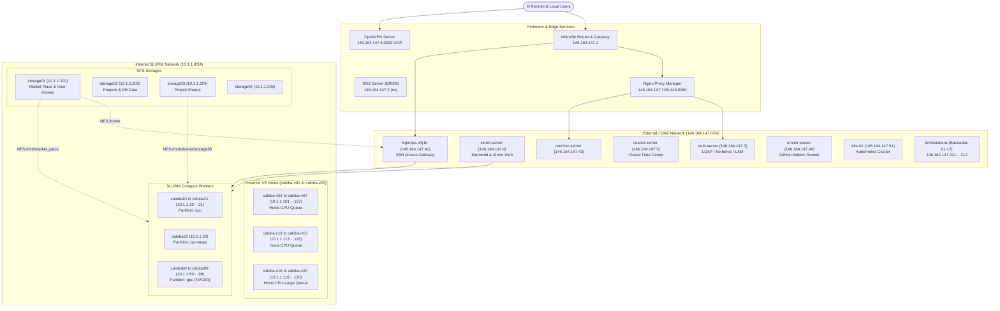

[](https://github.com/lps-ufrj-br/datacenter/actions/workflows/pages.yml)

# Caloba Cluster & Datacenter

This repository contains the configuration, infrastructure topology, automation playbooks, and management scripts for the **Caloba Cluster** at the Signal Processing Laboratory (LPS - UFRJ). The Caloba cluster is a High-Performance Computing (HPC) environment managed by **SLURM**, virtualized with **Proxmox VE**, authenticated via **OpenLDAP & Kerberos**, and connected to high-capacity **NFS storages**.

🌐 **Project Website:** [https://lps-ufrj-br.github.io/datacenter](https://lps-ufrj-br.github.io/datacenter)  
📖 **Infrastructure Topology:** [docs/Infrastructure.md](docs/Infrastructure.md)

---

## 🗺️ Summarized Infrastructure Topology



---

## 📚 Documentation Index

A comprehensive index of all component documentation and technical guides in this repository:

### 📖 Core Guides & Infrastructure (`docs/`)
- [Infrastructure Topology](docs/Infrastructure.md) — Detailed network topology, IPs, BIND DNS records, ports, and storage shares.
- [Proxmox VE Installation](docs/How_to_install_Proxmox.md) — Hypervisor installation, Corosync cluster setup, and GPU passthrough.
- [Debian OS Installation](docs/How_to_Install_Debian.md) — Base OS setup and configuration for physical nodes and VMs.
- [User Account Creation](docs/How_to_create_account.md) — Creating and managing user accounts across LDAP and Kerberos.
- [Bootable USB Drive](docs/How_to_create_bootable_pendrive.md) — Instructions for creating bootable installation media on Linux and macOS.
- [SLURM Workload Manager](docs/How_to_use_slurm.md) — Overview of job scheduling, partitions, and basic cluster usage.
- [Batch Jobs (`sbatch`)](docs/How_to_use_sbatch.md) — Writing batch job submission scripts and resource directives.
- [Singularity Usage](docs/How_to_use_singularity.md) — Running containerized workloads inside the SLURM cluster.
- [Singularity Image Building](docs/How_to_build_a_singularity_image.md) — Creating and compiling Singularity/Apptainer container definition files.
- [MSI Network Interface Fix](docs/How_to_fix_network_board_MSI.md) — Resolving driver and kernel issues on MSI onboard network cards.

### ⚙️ Servers & Services (`servers/`)
- [Servers Architecture Overview](servers/README.md) — Layout and grouping of essential services, external services, and nodes.
- **Essential Services** (`servers/essencial/`):
  - [Essential Services Overview](servers/essencial/README.md) — Overview of the core computing infrastructure components.
  - [Authentication Server](servers/essencial/auth-server/README.md) — OpenLDAP directory, Kerberos KDC, and LDAP Account Manager (LAM).
  - [DNS Server](servers/essencial/dns-server/README.md) — BIND9 authoritative DNS service for `lps.ufrj.br`.
  - [Login Server](servers/essencial/login-server/README.md) — Central SSH access bastion for cluster users.
  - [SLURM Controller](servers/essencial/slurm-server/README.md) — `slurmctld` controller daemon, munge key synchronization, and Slurm-Web.
  - [SSO Server](servers/essencial/sso-server/README.md) — Initial Single Sign-On setup instructions.
  - [VPN Server](servers/essencial/vpn-server/README.md) — Dockerized OpenVPN remote access gateway.
  - [VPN User Management](servers/essencial/vpn-server/scripts/README.md) — Scripts for client certificate generation and revocation (`create_user.sh`, `list_users.sh`, `revoke_user.sh`).
- **External Services** (`servers/external/`):
  - [External Services Overview](servers/external/README.md) — Services exposed outside the private compute cluster.
  - [GitHub Actions Runner](servers/external/runner-server/README.md) — Configuration of self-hosted GitHub Actions runners.
  - [Docker Server Stacks](servers/external/docker-server/composes/README.md) — Application compose stacks (Dorothy report service, PostgreSQL).
  - [Useful Composes](servers/composes/README.md) — Additional Docker Compose templates.
- **Compute Nodes & Workstations** (`servers/nodes/`):
  - [SLURM Worker Setup](servers/nodes/slurm-node/README.md) — Base Debian setup for SLURM worker nodes.
  - [Worker Post-Installation](servers/nodes/slurm-node/pos_install/README.md) — Automation recipes for Docker, Singularity fake roots, and NVIDIA GPU toolkit.
  - [Lab Workstations](servers/nodes/bancada-node/README.md) — Configuration and integration of physical laboratory workstations.

### 🧪 Scripts & Diagnostics (`scripts/`)
- [Stress Test Suite](scripts/README.md) — Automated concurrent CPU and GPU stress testing suite for SLURM partitions (`submit_stress.py`).

---

## 🎮 `play` CLI Complete Usage Guide

`play` is the official command-line management and automation tool for Proxmox VE clusters, virtual machines, and SLURM services.

### Installation and Environment Activation

The tool is part of the `datacenter` Python package. Activate the virtual environment or install the package in editable mode:

```bash
# Activate the existing virtual environment
source activate.sh

# Or install locally in editable mode
pip install -e .
```

Verify that the CLI is accessible:
```bash
play --help
```

---

### 🧩 Node Naming Pattern Syntax (`-n` / `--name`)

In virtual machine operations (`play vm`), the `-n` option supports flexible host expression patterns and range expansions:

| Pattern Syntax | Expansion Example | Command Example |
| :--- | :--- | :--- |
| **Single node** | `caloba51` | `play vm ping -n caloba51` |
| **Bracket range** | `caloba[51-54]` | Expands to `caloba51`, `caloba52`, `caloba53`, `caloba54` |
| **Hyphen range** | `caloba10-14` | Expands to `caloba10` through `caloba14` |
| **Combined ranges & lists** | `caloba10-21,60-71,50` | Expands to CPU nodes (10-21), GPU nodes (60-71), and large node (50) |

---

### 1️⃣ Proxmox VE Cluster Management (`play cluster`)

Manage physical Proxmox VE hypervisor clusters defined in [data/cluster.json](data/cluster.json).

#### 1.1 Test Connectivity (Ping)
Verify SSH/Ansible connectivity across all hypervisors belonging to a cluster partition:
```bash
play cluster ping -n gpu
play cluster ping -n cpu
play cluster ping -n cpu-large
```

#### 1.2 Create / Orchestrate Cluster
Initialize the master hypervisor, join secondary nodes to the Corosync cluster, and apply post-install settings:
```bash
play cluster create -n cpu-large
play cluster create -n gpu
```

#### 1.3 Reboot All Physical Nodes in a Cluster
Trigger a controlled, synchronized reboot playbook across all physical nodes in the specified cluster:
```bash
play cluster reboot -n cpu-large
```

#### 1.4 Destroy / Reset Cluster Configuration
Stop cluster services, remove Corosync configurations, and reset the hypervisors to standalone mode:
```bash
play cluster destroy -n cpu-large
```

*Tip: All commands support `--dry-run` for dry-run simulation and `-v` / `--verbose` for detailed Ansible execution output.*

---

### 2️⃣ Virtual Machine Lifecycle (`play vm`)

Provision, control, and inspect virtual machines across hypervisors.

#### 2.1 Create / Restore VM from Base Image
Restore the disk image using `qmrestore`, configure the static network interface, and power on the VM:
```bash
# Single node
play vm create -n caloba51

# Bracketed range of nodes
play vm create -n caloba[51-54]

# Multi-range batch provision
play vm create -n caloba10-21,60-71,50
```

#### 2.2 Destroy VM
Forcefully power off the VM and permanently delete its configuration and attached storage volumes:
```bash
play vm destroy -n caloba51
play vm destroy -n caloba[51-54]
```

#### 2.3 Test VM Connectivity (Ping)
Check whether the VM is online and responding via SSH using Ansible's ping module:
```bash
play vm ping -n caloba51
play vm ping -n caloba10-21
```

#### 2.4 Power Management (Start, Stop, Reboot)
Control the execution state of virtual machines on the Proxmox host:
```bash
# Power on stopped VM(s)
play vm start -n caloba51
play vm start -n caloba[60-71]

# Forcefully stop running VM(s) (qm stop)
play vm stop -n caloba51

# Reboot VM(s) (qm stop followed by qm start)
play vm reboot -n caloba51
play vm reboot -n caloba[10-21]
```

---

### 3️⃣ Disk Snapshots (`play vm snapshot` & `delsnapshot`)

Manage disk snapshots for quick rollbacks without saving volatile RAM state (`--vmstate 0`).

#### 3.1 Create Snapshot
```bash
# Snapshot with the default name ("base")
play vm snapshot -n caloba51

# Snapshot with a custom label
play vm snapshot -n caloba[51-54] -s pre_update
play vm snapshot -n caloba60 -s cuda12_install
```

#### 3.2 Delete Snapshot
```bash
# Remove default snapshot ("base")
play vm delsnapshot -n caloba51

# Remove snapshot by custom label
play vm delsnapshot -n caloba[51-54] -s pre_update
```

---

### 4️⃣ Remote Command Execution (`play vm run`)

Execute shell commands across VMs in parallel using Ansible. Commands can be chained using `&&`.

#### 4.1 Package Installation & Updates
```bash
play vm run -n caloba[51-54] -c "sudo apt update && sudo apt install -y htop nvtop"
```

#### 4.2 Infrastructure Maintenance Scripts
```bash
play vm run -n caloba[51-54] -c "sudo apt install -y new_package && source /mnt/market_place/scripts/install_root.sh"
```

#### 4.3 Update Singularity Fake Roots
```bash
play vm run -n caloba10-21,60-71,50 -c "python /mnt/market_place/scripts/datacenter/servers/nodes/slurm-node/pos_install/02_configure_singularity.py"
```

#### 4.4 Configure Docker Service & User Groups
```bash
# Install docker reset and restart service
play vm run -n caloba10-21,60-71,50 -c "bash /mnt/market_place/scripts/datacenter/servers/nodes/slurm-node/pos_install/01_configure_docker.sh"

# Add a user to the docker group
play vm run -n caloba10-21,60-71,50 -c "usermod -aG docker USERNAME"
```

#### 4.5 Configure NVIDIA Container Toolkit
```bash
play vm run -n caloba60-71 -c "bash /mnt/market_place/scripts/datacenter/servers/nodes/slurm-node/pos_install/03_configure_docker_gpu_toolkit.sh"
```

---

### 5️⃣ Hardware Resources & VM Options (`play vm options`)

Reconfigure vCPUs, RAM, boot options, and hardware passthrough directly via Proxmox `qm set`.

| Option Flag | Value Type | Description |
| :--- | :--- | :--- |
| `--boot` / `--no-boot` | Boolean | Start automatically on host system boot (`onboot=1` / `onboot=0`) |
| `--sockets` | Integer | Number of allocated virtual CPU sockets |
| `--cores` | Integer | Number of CPU cores per socket |
| `--memory` | Integer | Allocated RAM in Megabytes (MB) |
| `--balloon` | Integer | Minimum dynamic memory in MB (`0` to disable ballooning) |
| `--cpu` | String | CPU emulation model (e.g., `host`, `kvm64`) |
| `--set-device-from-config` | Flag | Apply PCI/GPU passthrough configuration defined in [data/cluster.json](data/cluster.json) |
| `--remove-unused-disks` | Flag | Purge unused residual disk references |

#### Usage Examples:

```bash
# Configure 2 sockets, 8 cores per socket, and 32 GB RAM for CPU worker nodes
play vm options -n caloba[10-21] --sockets 2 --cores 8 --memory 32768

# Enable autostart on host boot
play vm options -n caloba50 --boot

# Apply GPU PCI passthrough from cluster.json
play vm options -n caloba[60-71] --set-device-from-config

# Set CPU model to 'host' and disable memory ballooning
play vm options -n caloba50 --cpu host --balloon 0

# Clean up detached residual disks
play vm options -n caloba51 --remove-unused-disks
```

---

### 6️⃣ SLURM Services Management (`play slurm`)

Synchronize and manage the SLURM workload manager across the cluster.

#### 6.1 Restart and Synchronize SLURM
Propagates the `munge.key` authentication file across all nodes, reloads systemd, and restarts `slurmctld`, `slurmdbd`, and `slurmd`:
```bash
play slurm restart
```

Simulate with dry-run mode and verbose output:
```bash
play slurm restart --dry-run -v
```

---

## 🔗 Quick Links & Restricted Access

- 📊 [LPS Links and Accounts Spreadsheet](https://docs.google.com/spreadsheets/d/1PbJojKlb6sLdSm6FM86nqfK1CWD7uEgIkNA54eypAy0/edit?usp=sharing)
- 🏠 [LPS Infrastructure Main Portal](https://sites.google.com/lps.ufrj.br/infra/início)
- 🌐 [Datacenter Project Website](https://lps-ufrj-br.github.io/datacenter)


