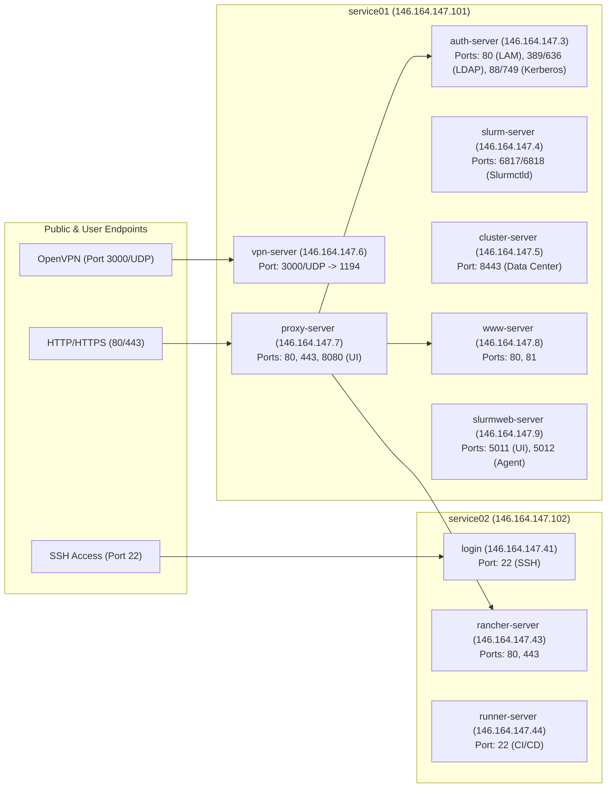
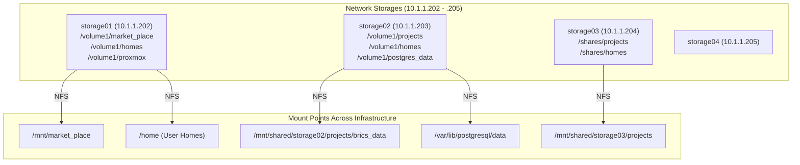

# Network and Infrastructure Configuration

This repository holds the documentation, installation scripts, and configurations to build and maintain each server and service within the LPS (Laboratório de Processamento de Sinais - UFRJ) lab infrastructure.

---

## 🗺️ Architecture Overview

```mermaid
flowchart TD
    Internet(["🌐 Internet / Remote Users"])

    subgraph Edge["Network Edge & Gateway"]
        GW["MikroTik Router / Gateway<br/>146.164.147.1<br/>Ports: 80, 443, 8291"]
        VPN["VPN Server (OpenVPN)<br/>146.164.147.6<br/>Port: 3000 UDP"]
        DNS["DNS Server (BIND9)<br/>146.164.147.2<br/>Port: 53 TCP/UDP"]
    end

    subgraph ExtNet["External Network (146.164.147.0/24)"]
        subgraph Srv01["Service01 Hypervisor (146.164.147.101:8006)"]
            AUTH["auth-server (LDAP/Kerberos/LAM)<br/>146.164.147.3<br/>Ports: 80, 389, 636, 88, 749"]
            SLURM_CTRL["slurm-server (Slurmctld)<br/>146.164.147.4<br/>Ports: 6817, 6818"]
            CLUSTER_SRV["cluster-server (Cluster Data Center)<br/>146.164.147.5<br/>Port: 8443"]
            PROXY["proxy-server (Nginx Proxy Manager)<br/>146.164.147.7<br/>Ports: 80, 443, 8080"]
            WWW["www-server (Redirects)<br/>146.164.147.8<br/>Ports: 80, 81"]
            SLURM_WEB["slurmweb-server<br/>146.164.147.9<br/>Ports: 5011, 5012"]
        end

        subgraph Srv02["Service02 Hypervisor (146.164.147.102:8006)"]
            LOGIN["login (SSH Gateway)<br/>146.164.147.41<br/>Port: 22"]
            RANCHER["rancher-server<br/>146.164.147.43<br/>Ports: 80, 443"]
            RUNNER["runner-server (CI/CD)<br/>146.164.147.44<br/>Port: 22"]
        end

        subgraph Srv03["Service03 Hypervisor (146.164.147.103:8006)"]
            Srv03_VMs["GPU Service VMs"]
        end

        subgraph K8s["Kubernetes Infrastructure"]
            K8S_NODE["k8s-01 (K8s Master/Worker)<br/>146.164.147.51<br/>Ports: 6443, 80, 443<br/>Apps: OpenProject, DTSP, GDI"]
        end

        subgraph Stations["Lab Stations & Peripherals"]
            BANCADA["Bancadas 01-12<br/>146.164.147.201 - .212"]
            DHCP["DHCP Pool (dyn 01-20)<br/>146.164.147.235 - .254"]
            PRINTERS["Printers (01-03, HP4200)<br/>146.164.147.12 - .14, .66"]
            FP["Fingerprint Service<br/>146.164.147.197"]
        end
    end

    subgraph IntNet["Internal Cluster Network (10.1.1.0/24)"]
        subgraph Storages["NFS & Management Storages"]
            ST01["storage01 (Market Place / Homes)<br/>10.1.1.202<br/>Ports: 5000, 5001, 2049"]
            ST02["storage02 (Projects / Data)<br/>10.1.1.203<br/>Ports: 5000, 2049"]
            ST03["storage03 (Projects / Shares)<br/>10.1.1.204<br/>Ports: 5000, 2049"]
            ST04["storage04<br/>10.1.1.205<br/>Ports: 5000, 2049"]
        end

        subgraph Hypervisors["Proxmox VE Cluster (caloba-v01 to caloba-v20)"]
            PVE_GPU["caloba-v01 to caloba-v07<br/>10.1.1.101 - 10.1.1.107:8006"]
            PVE_OTHERS["caloba-v08 to caloba-v12<br/>10.1.1.108 - 10.1.1.112:8006"]
            PVE_CPU["caloba-v13 to caloba-v15<br/>10.1.1.113 - 10.1.1.115:8006"]
            PVE_CPUL["caloba-v16 to caloba-v20<br/>10.1.1.116 - 10.1.1.120:8006"]
        end

        subgraph ComputeNodes["SLURM Compute Workers"]
            WORKER_CPU["caloba10 to caloba21 (CPU)<br/>10.1.1.10 - 10.1.1.21"]
            WORKER_CPUL["caloba50 (CPU Large)<br/>10.1.1.50"]
            WORKER_GPU["caloba60 to caloba99 (GPU)<br/>10.1.1.60 - 10.1.1.99"]
        end
    end

    Internet --> GW
    Internet --> VPN
    GW --> ExtNet
    VPN --> ExtNet
    VPN --> IntNet
    GW --- IntNet

    PROXY --> AUTH
    PROXY --> RANCHER
    PROXY --> WWW

    SLURM_CTRL --> ComputeNodes
    ST01 -. "NFS /mnt/market_place" .-> ComputeNodes
    ST01 -. "NFS /mnt/market_place" .-> ExtNet
    ST03 -. "NFS /mnt/shared/storage03" .-> ComputeNodes
```

---

## 🌐 Network Subnets

| Network | Subnet / CIDR | Gateway | DNS Servers | Purpose |
| :--- | :--- | :--- | :--- | :--- |
| **External (Public / Lab)** | `146.164.147.0/24` | `146.164.147.1` | `146.164.147.2`, `8.8.8.8`, `8.8.8.4` | Infrastructure services, hypervisors, lab workstations, DMZ services |
| **Internal (SLURM Cluster)** | `10.1.1.0/24` | `10.1.1.1` | `146.164.147.2`, `8.8.8.8`, `8.8.8.4` | Dedicated high-performance network for compute nodes, storages, and hypervisors |

---

## 🔗 Quick Links

### 🖥️ Proxmox Hypervisors

#### Service Hypervisors (External Network):
- [Proxmox Service 01](https://146.164.147.101:8006/) - Base LPS virtualization services
- [Proxmox Service 02](https://146.164.147.102:8006/) - External services & management
- [Proxmox Service 03](https://146.164.147.103:8006/) - Service virtualization with GPU

#### Compute Hypervisors (Internal Network `10.1.1.0/24`):
| Node | Web UI URL | Role / Primary Queue |
| :--- | :--- | :--- |
| `caloba-v01` | [https://10.1.1.101:8006/](https://10.1.1.101:8006/) | **GPU Queue Host** (`caloba60`, `caloba61`) |
| `caloba-v02` | [https://10.1.1.102:8006/](https://10.1.1.102:8006/) | GPU Nodes (`caloba62`, `caloba63`) |
| `caloba-v03` | [https://10.1.1.103:8006/](https://10.1.1.103:8006/) | GPU Nodes (`caloba64`, `caloba65`) |
| `caloba-v04` | [https://10.1.1.104:8006/](https://10.1.1.104:8006/) | GPU Nodes (`caloba66`, `caloba67`) |
| `caloba-v05` | [https://10.1.1.105:8006/](https://10.1.1.105:8006/) | GPU Nodes (`caloba68`, `caloba69`) |
| `caloba-v06` | [https://10.1.1.106:8006/](https://10.1.1.106:8006/) | GPU Nodes (`caloba70`, `caloba71`) |
| `caloba-v07` | [https://10.1.1.107:8006/](https://10.1.1.107:8006/) | GPU Nodes (`caloba72`, `caloba73`) |
| `caloba-v08` | [https://10.1.1.108:8006/](https://10.1.1.108:8006/) | PVE Compute Node |
| `caloba-v09` | [https://10.1.1.109:8006/](https://10.1.1.109:8006/) | PVE Compute Node |
| `caloba-v10` | [https://10.1.1.110:8006/](https://10.1.1.110:8006/) | PVE Compute Node |
| `caloba-v11` | [https://10.1.1.111:8006/](https://10.1.1.111:8006/) | PVE Compute Node |
| `caloba-v12` | [https://10.1.1.112:8006/](https://10.1.1.112:8006/) | PVE Compute Node |
| `caloba-v13` | [https://10.1.1.113:8006/](https://10.1.1.113:8006/) | **CPU Queue Host** (`caloba10` - `caloba13`) |
| `caloba-v14` | [https://10.1.1.114:8006/](https://10.1.1.114:8006/) | CPU Nodes (`caloba14` - `caloba17`) |
| `caloba-v15` | [https://10.1.1.115:8006/](https://10.1.1.115:8006/) | CPU Nodes (`caloba18` - `caloba21`) |
| `caloba-v16` | [https://10.1.1.116:8006/](https://10.1.1.116:8006/) | **CPU-Large Queue Host** (`caloba50`) |
| `caloba-v17` | [https://10.1.1.117:8006/](https://10.1.1.117:8006/) | PVE Compute Node |
| `caloba-v18` | [https://10.1.1.118:8006/](https://10.1.1.118:8006/) | PVE Compute Node |
| `caloba-v19` | [https://10.1.1.119:8006/](https://10.1.1.119:8006/) | PVE Compute Node |
| `caloba-v20` | [https://10.1.1.120:8006/](https://10.1.1.120:8006/) | PVE Compute Node |

---

### ⚡ SLURM Queues (Cluster Partitions)

| Queue | Hypervisor Host | Hypervisor Web UI | Target Compute VMs |
| :--- | :--- | :--- | :--- |
| **gpu** | `caloba-v01` | [https://10.1.1.101:8006/](https://10.1.1.101:8006/) | `caloba60` - `caloba99` (`10.1.1.60` - `10.1.1.99`) |
| **cpu** | `caloba-v13` | [https://10.1.1.113:8006/](https://10.1.1.113:8006/) | `caloba10` - `caloba21` (`10.1.1.10` - `10.1.1.21`) |
| **cpu-large** | `caloba-v16` | [https://10.1.1.116:8006/](https://10.1.1.116:8006/) | `caloba50` (`10.1.1.50`) |

---

### 🛠️ Infrastructure Services & Ports

| Service | FQDN / Hostname | IP Address | Port(s) | Description / Link |
| :--- | :--- | :--- | :--- | :--- |
| **Gateway Router** | `gw.lps.ufrj.br` | `146.164.147.1` | `80`, `443`, `8291` | MikroTik RouterOS Gateway |
| **DNS Server** | `ns.lps.ufrj.br` | `146.164.147.2` | `53` (TCP/UDP) | BIND9 Authoritative DNS |
| **LDAP & Kerberos** | `auth-server.lps.ufrj.br` | `146.164.147.3` | `80` (HTTP), `389` (LDAP), `636` (LDAPS), `88` (KDC), `749` (Kadmin) | [LDAP Account Manager](http://auth-server.lps.ufrj.br/lam/) |
| **SLURM Controller** | `slurm-server.lps.ufrj.br` | `146.164.147.4` | `6817` (slurmctld), `6818` (slurmd) | SLURM Workload Controller Frontend |
| **Cluster Data Center** | `cluster-server.lps.ufrj.br` | `146.164.147.5` | `8443` (HTTPS) | [Cluster Data Center](https://cluster-server.lps.ufrj.br:8443) |
| **VPN Server** | `vpn-server.lps.ufrj.br` | `146.164.147.6` | `3000` (UDP -> 1194 OpenVPN) | OpenVPN Remote Access Gateway |
| **Reverse Proxy** | `proxy-server.lps.ufrj.br` | `146.164.147.7` | `80` (HTTP), `443` (HTTPS), `8080` (Admin UI) | [Nginx Proxy Manager](http://proxy-server.lps.ufrj.br:8080/login) |
| **WWW Server** | `www-server.lps.ufrj.br` | `146.164.147.8` | `80` (Web redirect), `81` (GitLab redirect) | LPS Web Redirect Service |
| **SLURM Web** | `slurmweb-server.lps.ufrj.br` | `146.164.147.9` | `5011` (Web UI), `5012` (Agent Gateway) | [SLURM Web Dashboard](http://slurmweb-server.lps.ufrj.br:5011) |
| **Login Server** | `login.lps.ufrj.br` | `146.164.147.41` | `22` (SSH) | Central SSH entrypoint (`ssh cluster@login.lps.ufrj.br`) |
| **Rancher Server** | `rancher-server.lps.ufrj.br` | `146.164.147.43` | `80` (HTTP), `443` (HTTPS) | [Rancher UI](https://rancher.lps.ufrj.br) |
| **Runner Server** | `runner-server.lps.ufrj.br` | `146.164.147.44` | `22` (SSH) | CI/CD Job Runner Server |
| **Kubernetes Cluster** | `k8s-01.lps.ufrj.br` | `146.164.147.51` | `6443` (Kube API), `80`, `443` | Kubernetes Node hosting OpenProject, DTSP, GDI |
| **Fingerprint** | `fingerprint.lps.ufrj.br` | `146.164.147.197` | `80` (HTTP) | [Finger Print Attendance Service](http://fingerprint.lps.ufrj.br) |
| **Storage 01** | `storage01.lps.ufrj.br` | `10.1.1.202` | `5000` (HTTP), `5001` (HTTPS), `2049` (NFS) | [Storage 1 DSM](http://storage01.lps.ufrj.br:5000) (Market Place / Homes) |
| **Storage 02** | `storage02.lps.ufrj.br` | `10.1.1.203` | `5000` (HTTP), `5001` (HTTPS), `2049` (NFS) | [Storage 2 DSM](http://storage02.lps.ufrj.br:5000) (Projects / PostgreSQL Data) |
| **Storage 03** | `storage03.lps.ufrj.br` | `10.1.1.204` | `5000` (HTTP), `5001` (HTTPS), `2049` (NFS) | [Storage 3 DSM](http://storage03.lps.ufrj.br:5000) (Projects Share) |
| **Storage 04** | `storage04.lps.ufrj.br` | `10.1.1.205` | `5000` (HTTP), `5001` (HTTPS), `2049` (NFS) | [Storage 4 DSM](http://storage04.lps.ufrj.br:5000) |
| **pgAdmin** | `pgadmin.lps.ufrj.br` | `146.164.147.7` (CNAME) | `80` / `443` (proxied to `5050`) | [pgAdmin Web UI](http://pgadmin.lps.ufrj.br) |
| **Indico** | `indico.lps.ufrj.br` | `146.164.147.7` (CNAME) | `80` / `443` (proxied to `8080`) | [Indico Conference Management](http://indico.lps.ufrj.br) |
| **GitLab (Redirect)** | `gitlab.lps.ufrj.br` | `146.164.147.7` (CNAME) | `80` / `443` | Redirects to LPS GitLab Organization |

---

## 🖧 Physical Service Nodes (Hypervisors)

### `service01` (`146.164.147.101:8006`)
Physical host dedicated to base core infrastructure:
- `ns.lps.ufrj.br` (`146.164.147.2`): Authoritative DNS server (BIND9)
- `auth-server.lps.ufrj.br` (`146.164.147.3`): OpenLDAP directory, Kerberos KDC, and LDAP Account Manager (LAM)
- `slurm-server.lps.ufrj.br` (`146.164.147.4`): SLURM controller daemon (`slurmctld`)
- `cluster-server.lps.ufrj.br` (`146.164.147.5`): Cluster Data Center management UI
- `vpn-server.lps.ufrj.br` (`146.164.147.6`): OpenVPN server gateway (Port 3000 UDP)
- `proxy-server.lps.ufrj.br` (`146.164.147.7`): Nginx Proxy Manager (Ports 80, 443, 8080)
- `www-server.lps.ufrj.br` (`146.164.147.8`): Web redirect containers (Ports 80, 81)
- `slurmweb-server.lps.ufrj.br` (`146.164.147.9`): Slurm-web dashboard (Ports 5011, 5012)

### `service02` (`146.164.147.102:8006`)
Physical host dedicated to external/management services:
- `login.lps.ufrj.br` (`146.164.147.41`): Primary SSH login bastion for cluster users
- `rancher-server.lps.ufrj.br` (`146.164.147.43`): Rancher container management platform
- `runner-server.lps.ufrj.br` (`146.164.147.44`): CI/CD automation runner
- Docker server hosting compose stacks (e.g. Dorothy report service, postgres)

### `service03` (`146.164.147.103:8006`)
Physical virtualization server equipped with GPU passthrough for external services.

---

## 💾 Storage Architecture & Mounts

### Main Storage (`storage01` - `10.1.1.202`):
- Physical path: `10.1.1.202:/volume1/market_place`
- Mount target: `/mnt/market_place` on all cluster nodes and service VMs.
- Directory contents:
  - `/mnt/market_place/data`: Backup for LDAP and Kerberos databases.
  - `/mnt/market_place/module_file`: Environment modules binaries and definitions.
  - `/mnt/market_place/nvidia`: NVIDIA driver binaries, CUDA installers, toolkit packages.
  - `/mnt/market_place/slurm_build`: Slurm packages, `munge.key`, and Slurm configuration files.
  - `/mnt/market_place/volumes`: Persistent Docker volumes (`openvpn`, `proxy`, `indico`).
- User Homes: `10.1.1.202:/volume1/homes`
- Proxmox Backup: `10.1.1.202:/volume1/proxmox`

### Project Storage (`storage02` - `10.1.1.203` & `storage03` - `10.1.1.204`):
- `storage02` (`10.1.1.203:/volume1/projects`): Shared research data (e.g., BRICS / Dorothy data).
- `storage02` (`10.1.1.203:/volume1/postgres_data`): PostgreSQL database volume.
- `storage03` (`10.1.1.204:/shares/projects`): Mounted at `/mnt/shared/storage03/projects`.

---

## 🖨️ Lab Workstations, Hardware & DHCP

### Fixed Workstations (Bancadas):
- IP Range: `146.164.147.201` - `146.164.147.212` (`bancada01` to `bancada12`)
- Subnet mask: `255.255.255.0`, Gateway: `146.164.147.1`

### Dynamic DHCP Pool:
- IP Range: `146.164.147.235` - `146.164.147.254` (`dyn-01` to `dyn-20`)

### Network Hardware & Printers:
- `gw.lps.ufrj.br` (`146.164.147.1`): MikroTik Gateway Router
- `lps1-wlan.lps.ufrj.br` (`146.164.147.65`): Lab Wi-Fi Access Point
- `printer01.lps.ufrj.br` (`146.164.147.12`): Network Printer 01
- `printer02.lps.ufrj.br` (`146.164.147.13`): Network Printer 02
- `printer03.lps.ufrj.br` (`146.164.147.14`): Network Printer 03
- `hp4200dtn.lps.ufrj.br` (`146.164.147.66`): HP LaserJet 4200DTN Printer

---

## 🔒 Restricted Access & Useful Links

- 📊 [Links and Accounts Spreadsheet](https://docs.google.com/spreadsheets/d/1PbJojKlb6sLdSm6FM86nqfK1CWD7uEgIkNA54eypAy0/edit?usp=sharing)
- 🏠 [LPS Administrator Main Page](https://sites.google.com/lps.ufrj.br/infra/início)

